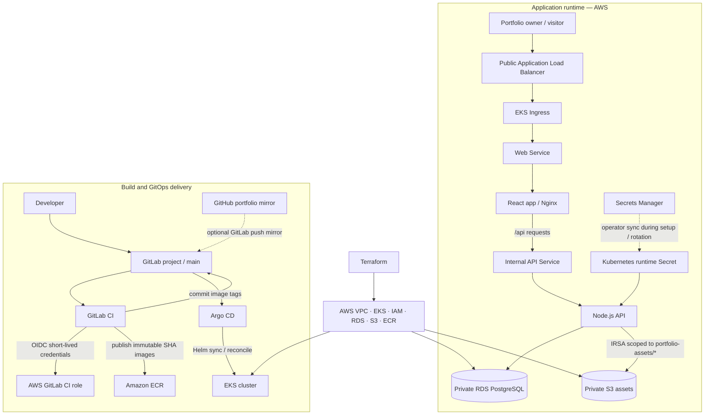

# ShowcaseMe — Portfolio Builder on AWS EKS

> **Portfolio project · Amazon EKS · Terraform · Helm · Argo CD · GitLab CI**

ShowcaseMe lets users create, edit, publish and manage a professional portfolio. This AWS variant demonstrates a Kubernetes delivery platform: Terraform defines the AWS foundation, GitLab CI validates and publishes immutable container images, and Argo CD reconciles the Helm release from Git.

## At a glance

| Area | Implementation |
|---|---|
| Application | React frontend · Node.js API · PostgreSQL |
| Runtime | Amazon EKS managed node groups |
| Networking | VPC · public ALB subnets · private worker/database subnets · NAT |
| Packaging | Docker images in Amazon ECR · Helm chart |
| Infrastructure | Terraform (VPC, EKS, IAM/IRSA, RDS, S3, ECR) |
| CI and image publication | GitLab CI · OIDC to AWS · ECR immutable SHA tags |
| CD / GitOps | Argo CD reconciles Git-managed Helm values |
| Scaling | Kubernetes HPA · EKS managed node group · Cluster Autoscaler |
| Security | Private RDS · S3 Block Public Access · scoped IRSA · restricted EKS API CIDRs |

## Architecture

The ingress sends browser traffic to the web Service. Nginx serves the React application and forwards `/api/*` requests to the internal API Service; the API accesses private RDS and S3 using its IRSA role.



### Release flow

1. Change application, infrastructure or Helm source in the GitLab project (import or mirror this GitHub repository there first).
2. GitLab merge-request pipelines validate API tests, frontend build, Terraform, Helm and container builds.
3. On the default branch, GitLab CI obtains short-lived AWS credentials through OIDC and publishes API/web images to ECR using `sha-$CI_COMMIT_SHA` tags.
4. The promotion job commits both image tags to `deploy/helm/showcaseme/values-aws.yaml` in GitLab.
5. Argo CD watches that GitLab branch/path and reconciles the Helm release to EKS. GitLab CI does not run `kubectl apply` or `helm upgrade` against the application.
6. Verify the rollout, ingress, readiness, logs, RDS and S3 access. Roll back by reverting the GitOps image-promotion commit.

GitHub Actions is a separate repository-validation workflow. It does **not** deploy AWS infrastructure or run the GitLab release pipeline. A GitLab push mirror back to GitHub is optional and is not required for Argo CD, which reads GitLab directly.

## Repository map

```text
.
├── api/                              # Express API, SQL migrations and tests
├── web/                              # React application and Nginx reverse proxy
├── infra/terraform/                  # VPC, EKS, RDS, S3, ECR and IAM
├── deploy/
│   ├── helm/showcaseme/              # Chart, AWS values and Kubernetes templates
│   └── argocd/                       # Application, metrics-server and Cluster Autoscaler
├── .gitlab-ci.yml                    # GitLab validate → build → publish → promote
├── .github/workflows/validate.yml    # GitHub repository validation only
└── docs/                             # Architecture, deployment, security and operations
```

## Documentation guide

| Guide | What it covers |
|---|---|
| [Architecture](docs/architecture.md) | Runtime request path, network boundaries and delivery/GitOps flow |
| [Deployment runbook](docs/deployment.md) | Terraform, secrets, EKS access, controllers, GitLab CI and Argo CD setup |
| [Kubernetes delivery](deploy/README.md) | GitLab variables, GitOps source and controller installation |
| [Troubleshooting](docs/troubleshooting.md) | Pod, RDS, S3, ingress, autoscaling and GitOps incidents |
| [Operations and acceptance](docs/operations-acceptance.md) | Preflight, deployment order, release checks and rollback |
| [Security](docs/security.md) | IAM, secrets, network and workload security considerations |
| [Costs](docs/costs.md) | Billable resources and lab cost controls |

## Local development and validation

Prerequisites: Node.js 22, Docker Engine and Docker Compose v2.

```bash
cp .env.example .env
# Set POSTGRES_PASSWORD and JWT_SECRET in .env.
docker compose up --build
```

Open [http://localhost:8080](http://localhost:8080). Compose starts PostgreSQL, the API and the web container.

The repository's GitHub Actions workflow runs API/PostgreSQL integration tests, frontend build, Terraform formatting/validation and Helm rendering. GitLab CI uses the committed npm lockfiles and `npm ci`. Neither CI workflow silently rewrites dependencies.

## AWS setup

Read the [deployment runbook](docs/deployment.md) before provisioning. Use a dedicated sandbox account, configure encrypted remote Terraform state for shared use, set your own EKS administrator CIDR, review the full plan and configure an AWS Budget. EKS, EC2 nodes, RDS, NAT Gateway and ALB have ongoing costs.

## Evidence and scope

- Application, Terraform, Helm, GitLab CI and Argo CD definitions are source-controlled.
- GitHub validation and Helm render checks are reproducible from Actions.
- Cloud deployment is operator-run and requires an AWS account, Terraform apply, GitLab project/variables, OIDC trust, controller installation and Argo CD configuration.
- The resume's **12-to-8-minute** release improvement remains an unverified target until comparable, timestamped deployments are measured.

This is a hands-on portfolio implementation, not a claim of an already-running production environment. The design favors traceable releases, immutable artifacts, scoped identities, Git as the desired-state source and documented recovery procedures.
