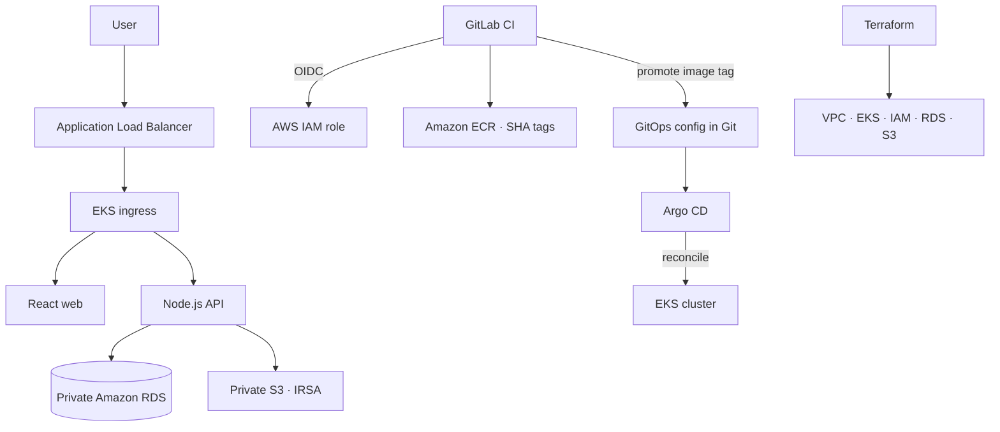

# ShowcaseMe — Portfolio Builder on AWS EKS

> **Portfolio project · Amazon EKS · Terraform · Helm · Argo CD · GitLab CI**

ShowcaseMe lets users create, edit, publish and manage a professional portfolio. This AWS variant demonstrates a Kubernetes delivery platform: Terraform builds the AWS foundation, GitLab CI validates and packages application releases, and Argo CD reconciles the cluster from Git.

## At a glance

| Area | Implementation |
|---|---|
| Application | React frontend · Node.js API · PostgreSQL |
| Runtime | Amazon EKS managed node groups |
| Packaging | Docker images in Amazon ECR · Helm chart |
| Infrastructure | Terraform (VPC, EKS, IAM, RDS, S3 and supporting resources) |
| CI | GitLab CI (tests, builds, ECR publication, GitOps promotion) |
| CD / GitOps | Argo CD reconciles Git-managed Helm configuration |
| Scaling | Kubernetes HPA + EKS node-group autoscaling |
| Security | Private RDS/S3, IRSA, scoped RBAC, private worker subnets |

## Architecture



## Repository map

```text
.
├── api/                         # API, SQL migrations and tests
├── web/                         # React application
├── infra/terraform/              # AWS foundation and workload identities
├── deploy/
│   ├── helm/showcaseme/         # Chart, values and Kubernetes templates
│   └── argocd/                  # Application and platform add-ons
├── .gitlab-ci.yml                # Validate → build → publish → promote
├── .github/workflows/validate.yml # Local/CI validation (no AWS deployment)
└── docs/                          # Architecture, security, operations and cost
```

## Release flow

1. **Change** — work on API, web, chart or infrastructure in a branch.
2. **Review** — GitLab merge-request pipeline runs API tests, frontend build, Terraform validation, Helm lint/render and image build.
3. **Merge** — protected default branch is the release source.
4. **Build & publish** — GitLab CI assumes its AWS role through OIDC and pushes commit-SHA images to ECR.
5. **Promote** — pipeline updates the AWS Helm values with the immutable image tag in Git.
6. **Reconcile** — Argo CD detects Git drift and synchronizes the desired release to EKS.
7. **Verify / rollback** — inspect rollout, ingress, health and logs; revert the GitOps commit to restore the prior desired version.

GitLab CI is the build/promotion orchestrator; **Argo CD is the cluster deployment reconciler**. CodeBuild is intentionally not part of this design.

## Local development and validation

Prerequisites: Node.js 22, Docker, PostgreSQL, Terraform and Helm.

```bash
cp .env.example .env
docker compose up --build
```

The GitHub Actions validation workflow is a reproducible repository check (API/PostgreSQL integration tests, frontend build, Terraform validation and Helm rendering). GitLab CI installs committed npm lockfiles with `npm ci`; CI does not rewrite dependency locks. It does **not** deploy AWS infrastructure.

## AWS setup

Read [deployment guide](deploy/README.md) before provisioning. Configure Terraform state, AWS OIDC trust for GitLab, ECR repositories, EKS access, RDS credentials, IRSA, Argo CD and GitOps repository permissions. Review every Terraform plan and use budgets: EKS, EC2 nodes, RDS, NAT and ALB have ongoing costs.

## Evidence and scope

- Application and infrastructure definitions are source-controlled.
- GitHub validation and Helm render checks can be reproduced from CI.
- The resume's **12-to-8-minute** release improvement is a target claim pending repeatable, timestamped measurements.

## Design principles

Declarative infrastructure, immutable image tags, least-privilege workload identity, Git-based desired state, explicit rollback, and honest evidence. This is a portfolio-grade implementation intended to be understandable, reproducible and extendable.
