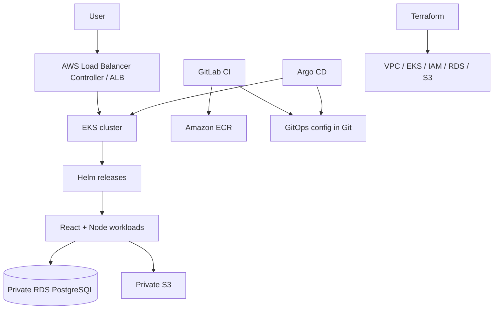

# ShowcaseMe — Portfolio Platform on AWS EKS

AWS implementation of the portfolio-building and publishing platform, kept separate from the GCP ShowcaseMe repository.

## Target architecture (AWS resume)

- React frontend + Node.js API; PostgreSQL on Amazon RDS in private subnets.
- Amazon EKS with managed node groups; images in ECR.
- Terraform for VPC, EKS, IAM and supporting resources.
- Helm packages application deployments, services, probes, resource requests/limits and HPA.
- Argo CD reconciles Git-hosted Helm values/manifests (GitOps); Git revert is the rollback mechanism.
- GitLab CI validates/tests and coordinates image build/publish; AWS CodeBuild is **not** included in the current v14 resume stack.
- Private S3 bucket with Block Public Access and least-privilege IAM.
- IAM Roles for Service Accounts (IRSA), scoped Kubernetes RBAC and private RDS.

## Architecture

## Status and honesty
GitHub Actions validation has passed for API tests, frontend build, Docker image builds, Terraform fmt/init/validate and Helm lint/template rendering. GitLab CI and the live AWS EKS deployment still require an actual GitLab project and AWS account configuration. The 12-to-8-minute release improvement is **not claimed until measured**. This repository does not provision resources automatically.

## Cost warning
EKS control plane, EC2 node groups, RDS, NAT Gateway, load balancers and data transfer can incur ongoing charges. Review plans and configure budgets before deployment. Tear down environments when not needed.
