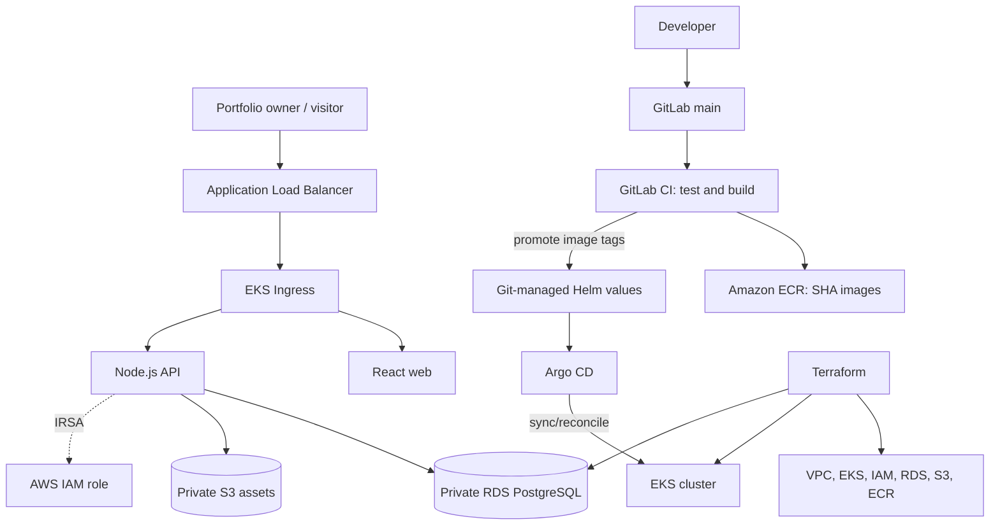

# AWS ShowcaseMe architecture

## Runtime and delivery

- **Application:** React web and Node.js API run as separate EKS workloads, packaged by Helm.
- **Database:** PostgreSQL on private Amazon RDS; credentials are injected from Secrets Manager into a Kubernetes runtime Secret.
- **Assets:** S3 is private with Block Public Access; API access uses IRSA scoped to the portfolio-assets prefix.
- **Infrastructure:** Terraform manages VPC, EKS, IAM, ECR, RDS, S3 and supporting resources.
- **GitOps:** Argo CD watches the GitLab repository's `main` branch and `deploy/helm/showcaseme` path. Rollback is a Git revert followed by reconciliation.
- **CI/CD:** GitLab CI validates, builds and publishes commit-SHA images to ECR, then promotes tags in `values-aws.yaml`. Argo CD—not GitLab CI—applies the desired state. GitHub Actions validates repository code/config only. CodeBuild is intentionally not used.

## Architecture and flow

## Trust boundaries

- EKS worker nodes and RDS are in private subnets; public ingress is through the AWS Load Balancer Controller-managed ALB.
- RDS is encrypted and not publicly accessible; PostgreSQL ingress is limited to the EKS cluster security group.
- S3 blocks public access and uses encryption/versioning.
- GitLab obtains short-lived AWS credentials through OIDC; API, Cluster Autoscaler and Load Balancer Controller use separate IRSA roles.
- Kubernetes API access is restricted by the configured administrator CIDR. The example loopback CIDR is a safe placeholder, not an operator-ready value.
