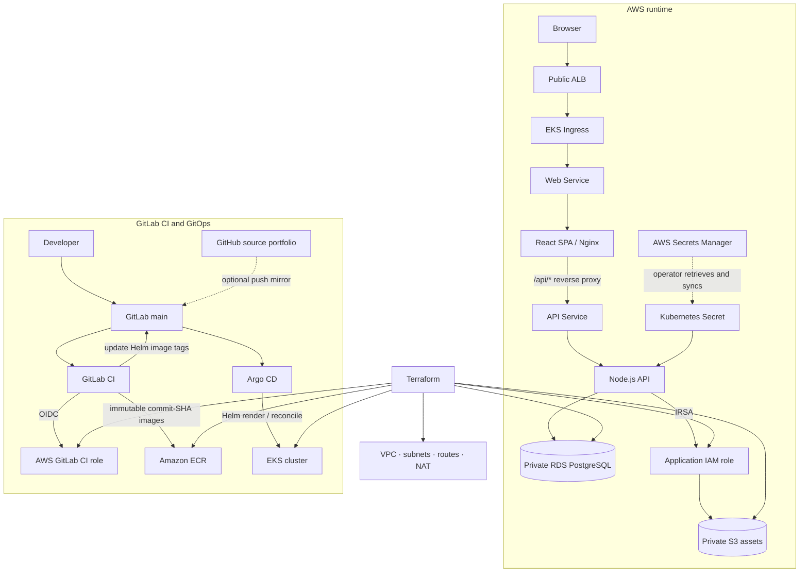

# AWS ShowcaseMe architecture

## Runtime components and request path

- **Ingress:** The AWS Load Balancer Controller provisions a public Application Load Balancer from the Kubernetes Ingress.
- **Web:** The Ingress routes `/` to the web Service. Nginx serves the React application and proxies `/api/*` to the internal `showcaseme-api` Service.
- **API:** Node.js/Express runs as a separate EKS Deployment. It reads the `showcaseme-runtime` Kubernetes Secret for `DATABASE_URL` and `JWT_SECRET`.
- **Database:** PostgreSQL runs on encrypted, non-public Amazon RDS in private subnets. Its security group permits PostgreSQL ingress from the EKS cluster security group.
- **Assets:** The S3 bucket is private, encrypted and versioned. The API uses IRSA with object permissions scoped to `portfolio-assets/*`.
- **Infrastructure:** Terraform defines the VPC, public/private subnet routing, NAT, EKS, managed node group, ECR, RDS, S3 and IAM/OIDC roles.
- **Scaling:** HPA controls API/web pod replicas; the EKS managed node group defines node capacity and Cluster Autoscaler can adjust its desired size.

## Runtime and delivery architecture

GitLab is the deployment source for this AWS variant. The repository is published on GitHub, but the AWS GitOps design expects a GitLab project at the path configured by Terraform. GitLab CI updates the Helm values in GitLab; Argo CD reads that GitLab project and reconciles EKS. A GitLab push mirror to GitHub is optional.

## Delivery responsibilities

| Component | Responsibility |
|---|---|
| GitHub Actions | Repository validation (application, Terraform and Helm); no AWS deployment |
| GitLab CI | API tests, web build, Terraform/Helm validation, Docker builds, OIDC authentication, ECR publication and GitOps tag promotion |
| Amazon ECR | Stores API and web images tagged with immutable source commit SHAs |
| Argo CD | Watches GitLab `main` and `deploy/helm/showcaseme`; reconciles `values-aws.yaml` to EKS |
| Terraform | Provisions AWS infrastructure and the IAM roles used by workloads/controllers/CI |

GitLab CI does not run `kubectl apply` or `helm upgrade` for the application. It publishes images and changes desired state in Git; Argo CD performs the Kubernetes reconciliation.

## Network and security boundaries

- The public ALB is placed in public subnets; EKS managed worker nodes and RDS use private subnets.
- A single NAT Gateway provides private-subnet egress. This is a cost-optimized lab topology with an Availability Zone dependency, not a multi-AZ NAT design.
- The EKS API endpoint has public access restricted to `cluster_admin_cidrs`; private endpoint access is also enabled. Replace the safe `127.0.0.1/32` example before applying.
- RDS has no public access. Its security group accepts PostgreSQL traffic only from the EKS cluster security group.
- S3 Block Public Access, server-side encryption and versioning are enabled.
- Separate IAM identities are used for EKS control plane/nodes, application IRSA, Cluster Autoscaler, AWS Load Balancer Controller and GitLab CI OIDC.
- GitLab CI uses short-lived OIDC credentials; no long-lived AWS access keys are needed.

## Secrets lifecycle

Terraform generates the RDS credentials and JWT secret and stores them in AWS Secrets Manager. The deployment runbook shows an operator retrieving those values and creating the Kubernetes Secret `showcaseme-runtime`. The checked-in manifests do not implement an automatic Secrets Manager-to-Kubernetes synchronization controller. Secret rotation therefore requires updating the Kubernetes Secret and restarting the API Deployment.

## Resilience and scaling

Readiness/liveness probes gate API and web traffic. HPA controls workload replicas; Cluster Autoscaler can change managed-node-group capacity within Terraform's configured minimum and maximum. PodDisruptionBudgets are rendered by Helm. RDS automated backups are configured, but the sample is single-AZ and should not be presented as a highly available production database without changing the configuration and validating recovery.
